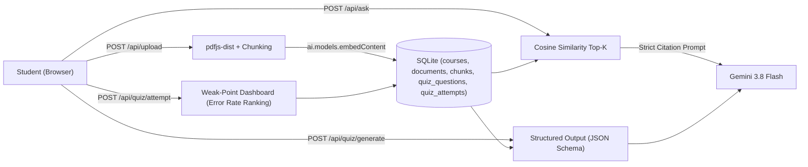

# StudyPilot

**StudyPilot** is an AI teaching assistant for university course materials, powered by Google Gemini (`@google/genai`).

## Completed Milestones: M1 – M3

- **M1 — MVP: PDF Q&A**: PDF upload validation (`<= 20 MB`, MIME + `%PDF-` header check) and Gemini Q&A.
- **M2 — RAG with Page Citations**: Per-page PDF parsing (`pdfjs-dist`), overlapping chunking, `gemini-embedding-001` vectors stored in SQLite (`node:sqlite`), SHA-256 embedding cache, Top-K cosine similarity retrieval, and clickable `[p.12]` citations.
- **M3 — Quiz & Weak-Point Tracking**:
  - Auto-generates 4-option multiple-choice questions using **Gemini Structured Output (`response_format` JSON Schema)**: `{ question, options[4], answerIndex, explanation, topic, sourcePage }`.
  - Records every student attempt in `quiz_attempts` and computes per-topic accuracy & error rate.
  - Displays a live **Weak-Point Tracking Dashboard** ranking topics by error rate descending.



## Setup & Run (Windows PowerShell)

1. **Install dependencies**:
   ```powershell
   npm install
   ```

2. **Configure environment variables**:
   ```powershell
   Copy-Item .env.example .env
   ```
   Open `.env` and set your `GEMINI_API_KEY`.

3. **Run the server**:
   ```powershell
   npm run dev
   ```
   Open `http://localhost:3000` in your browser.

4. **Run automated tests**:
   ```powershell
   npm test
   ```
